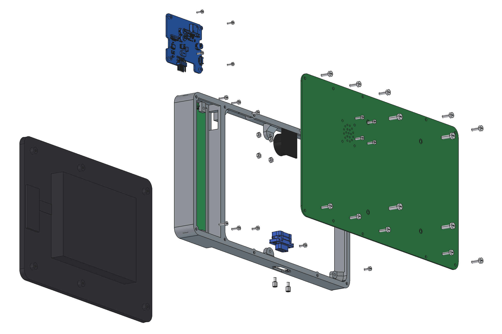

# JC8012P4A1C Enclosure & CAN Addon System

Enclosure, mounting and CAN/Power addon board for the Guition JC8012P4A1C (ESP32-P4, 10.1")
display, used by [espVT](https://github.com/Meisterschulen-am-Ostbahnhof-Munchen/espVT).

The system integrates an ISOBUS/CAN interface, 12 V power supply, a 3D-printed enclosure frame,
and an FR4 backplate with VESA 100 mount and speaker. An optional second variant extends the unit
with a 12-key tactile keypad next to the display.

**Online:** interactive BOMs, schematics and drawings at
<https://meisterschulen-am-ostbahnhof-munchen.github.io/JC8012P4A1C_I_W_Y_CAN/>



## Repository Structure

The project is structured into PCBs, mechanics and final assembly:

```text
JC8012P4A1C_I_W_Y_CAN/
├── pcbs/
│   ├── can_power/        # CAN-Bus & 12V/5V power supply addon board
│   ├── backplate/        # FR4 backplate with VESA 100 mount & speaker grille (variant 1)
│   ├── backplate_keypad/ # Widened FR4 backplate for variant 2 (with keypad)
│   └── keypad/           # 12-key tactile keypad PCB (variant 2)
├── mechanics/            # 3D printed frame designs (FreeCAD scripts, STL & STEP files)
├── assembly/             # Assembly drawings (A3 PDF), 3D render models & assembly scripts
├── assembly_bom.csv      # Complete mechanical parts, fasteners & cables BOM
├── mouser_order.csv      # Ordering list for non-Würth components
└── README.md
```

## Variants

| Component | Variant 1 (Standard) | Variant 2 (with Keypad) |
|---|---|---|
| Display | Guition JC8012P4A1C (10.1" ESP32-P4) | Guition JC8012P4A1C (10.1" ESP32-P4) |
| CAN / Power Board | [`pcbs/can_power/`](pcbs/can_power/README.md) | [`pcbs/can_power/`](pcbs/can_power/README.md) |
| Frame | `mechanics/frame.stl` | `mechanics/frame_keypad.stl` |
| Backplate | [`pcbs/backplate/`](pcbs/backplate/README.md) | [`pcbs/backplate_keypad/`](pcbs/backplate_keypad/README.md) (296.9 mm wide) |
| Keypad | — | [`pcbs/keypad/`](pcbs/keypad/README.md) (12 tactile keys F1–F12) |
| Assembly Drawing | [assembly/JC8012P4A1C_assembly_variant1.pdf](assembly/JC8012P4A1C_assembly_variant1.pdf) | [assembly/JC8012P4A1C_assembly_variant2_keypad.pdf](assembly/JC8012P4A1C_assembly_variant2_keypad.pdf) |

Details on mechanics: [mechanics/README.md](mechanics/README.md).  
Details on assembly: [assembly/README.md](assembly/README.md).

## Bills of Materials (BOM)

| BOM | File |
|---|---|
| CAN & Power board | [pcbs/can_power/production/JC8012P4A1C_I_W_Y_CAN_bom.csv](pcbs/can_power/production/JC8012P4A1C_I_W_Y_CAN_bom.csv) |
| Back plate (variant 1) | [pcbs/backplate/production/JC8012P4A1C_backplate_bom.csv](pcbs/backplate/production/JC8012P4A1C_backplate_bom.csv) |
| Back plate (variant 2, keypad) | [pcbs/backplate_keypad/production/JC8012P4A1C_backplate_keypad_bom.csv](pcbs/backplate_keypad/production/JC8012P4A1C_backplate_keypad_bom.csv) |
| Keypad (variant 2) | [pcbs/keypad/production/JC8012P4A1C_keypad_bom.csv](pcbs/keypad/production/JC8012P4A1C_keypad_bom.csv) |
| Final assembly (mechanical fasteners, cables) | [assembly_bom.csv](assembly_bom.csv) |
| Parts to order at Mouser (all non-Würth parts) | [mouser_order.csv](mouser_order.csv) |

### Interactive HTML BOMs (Assembly Checklists)

For manual assembly, interactive HTML BOMs (with checkboxes for soldering and inspection) are provided:

| Board | Interactive BOM |
|---|---|
| CAN & Power board | [pcbs/can_power/production/JC8012P4A1C_I_W_Y_CAN_ibom.html](pcbs/can_power/production/JC8012P4A1C_I_W_Y_CAN_ibom.html) |
| Back plate | [pcbs/backplate/production/JC8012P4A1C_backplate_ibom.html](pcbs/backplate/production/JC8012P4A1C_backplate_ibom.html) |
| Back plate (keypad variant) | [pcbs/backplate_keypad/production/JC8012P4A1C_backplate_keypad_ibom.html](pcbs/backplate_keypad/production/JC8012P4A1C_backplate_keypad_ibom.html) |
| Keypad | [pcbs/keypad/production/JC8012P4A1C_keypad_ibom.html](pcbs/keypad/production/JC8012P4A1C_keypad_ibom.html) |

## Manufacturing

Each PCB folder in `pcbs/` contains its complete KiCad 10 project, local component libraries (`lib/`), documentation (`docs/`), and fabrication outputs (`production/`).
See the respective README files in [`pcbs/can_power/`](pcbs/can_power/README.md), [`pcbs/backplate/`](pcbs/backplate/README.md), [`pcbs/backplate_keypad/`](pcbs/backplate_keypad/README.md), and [`pcbs/keypad/`](pcbs/keypad/README.md) for generation commands and specifications.

The 3D-printable frame is generated using FreeCAD scripts in [`mechanics/`](mechanics/README.md).

## Licence

- Schematics, PCB layouts, scripts and documentation: GPL-3.0 ([LICENSE](LICENSE)).
- `pcbs/*/lib/` and `assembly/models/`: symbols, footprints and 3D models from the Würth Elektronik eiSos libraries, licensed CC BY-SA 4.0 with the Würth exception for designs that use them (see `Wurth_Disclaimer_READ_ME.txt` in these folders).
- Footprints and 3D models from the KiCad standard libraries: CC BY-SA 4.0 with the KiCad exception.
- `mechanics/`: derivative of a Thingiverse design by 8bitmcu, CC BY-SA, see [mechanics/LICENSE.md](mechanics/LICENSE.md).
