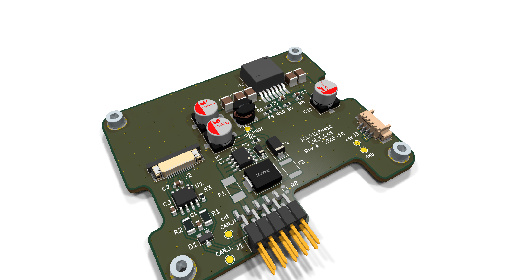

# JC8012P4A1C_I_W_Y_CAN
JC8012P4A1C_I_W_Y addon PCB for CAN-Bus

ISOBUS / CAN interface (250 kbit/s) for the Guition JC8012P4A1C (ESP32-P4, 10.1")
display, used by [espVT](https://github.com/Meisterschulen-am-Ostbahnhof-Munchen/espVT).
The board is mounted on the back of the display board and powered from the 12 V
board net. It also supplies 5 V to the display board.

KiCad 10 project. Project-local libraries are in `lib/`.



Top view: [docs/board_3d_top.png](docs/board_3d_top.png)

## Connections

| Connector | Part | Purpose |
|---|---|---|
| J1 | Würth WR-PHD 610110249121 (2×5 pin header, SMT, right angled) | ribbon cable to IDC D-Sub 9 female Würth 618009227221 |
| J2 | Würth WR-FPC 68711414522 (14 pin, 0.5 mm) | FFC to FPC3 "EXTEND1" of the display board |
| J3 | Würth WR-WTB 653104131822 (4 pin, 1.25 mm) | 5 V to CN2 of the display board |

### D-Sub 9 (via ribbon cable on J1)

Pinout of the Müller-Elektronik BASIC-Terminal CAN-ISO connector. It fits the
adapter cable 481595 (D-Sub 9 male to In-Cab CPC-9 female).

| D-Sub | J1 | Signal |
|---|---|---|
| 1 | 1 | CAN_L |
| 2 | 3 | CAN_L |
| 3 | 5 | TBC_GND (see R8) |
| 4 | 7 | CAN_H |
| 5 | 9 | TBC_PWR_in (not used) |
| 6 | 2 | ECU_GND |
| 7 | 4 | CAN_H |
| 8 | 6 | TBC_PWR_out |
| 9 | 8 | ECU_PWR (12 V board net) |
| – | 10 | not used |

CAN_L (1/2) and CAN_H (4/7) are connected on the board to loop the bus through.

**Polarisation:** J1 has no shroud (an 8 mm high part is the maximum under
the cover, a box header with IDC socket would be too high). To prevent the
IDC socket from being plugged in turned by 180°, cut off pin 10 of J1 and
close position 10 of the IDC socket with a coding plug. Pin 10 is marked
"cut" on the silkscreen. Pins 9 and 10 are
not used. Plugged in turned, the bus TBC_PWR and ECU_PWR (12 V) would end up
on the board GND and CAN_L.

## Mechanics

- All parts on the top side (SMT only), nothing on the bottom side
- Stack height: cover 14 mm − display board 1.5 mm − M2 standoffs 3 mm −
  addon board 1.5 mm ≈ 8 mm free above the addon board
- Fixing on the 58 × 46 mm grid of the display board standoffs S1–S4
  (H1 = S1, H2 = S4, H3 = S2, H4 = S3): SMD steel spacers Würth WA-SMST
  9774025943R (L 2.5 mm, through hole 2.25 mm), land pattern as in the
  datasheet: 5.3 mm GND pad on top, 3.0 mm **non-plated** hole for the
  Ø 2.8 × 1.4 mm collar of the spacer. The DRC rule in
  `JC8012P4A1C_I_W_Y_CAN.kicad_dru` allows the pad right up to the hole.
- Screws **M2×6**, without washer: spacer 2.5 mm + PCB 1.6 mm leaves 1.9 mm
  thread engagement in the 2.5 mm deep blind thread of S1–S4. M2×8 would
  bottom out.
- Notches for CN5 (pin header), the 100 µF capacitor next to S4 and the
  CR1220 RTC holder of the display board

### FPC3 (J2)

| Pin | Signal |
|---|---|
| 1, 2 | GND |
| 7 | CAN_RXD (GPIO5) |
| 8 | CAN_TXD (GPIO4) |
| 9 | CAN_NEN (GPIO3, 10k pull-down: transceiver active by default) |
| 13, 14 | +3V3 (VDDA, transceiver VIO) |

FFC: 14 pin, 0.5 mm pitch, **type B (contacts on opposite sides)**.
The cable leaves FPC3 towards the board edge, makes one 180° turn and enters
J2 from the edge of the addon board. Both connectors are bottom-contact ZIF
with the same orientation (opening towards the edge, pin 1 on the right
side seen from the back of the display, next to the TF card), so pin 1
connects to pin 1. A type A cable would have its contacts facing up at J2;
turning it over to make it fit reverses the pin order and swaps GND (1/2)
and 3V3 (13/14).

## Termination

ISO 11783-2 ECU Type I WEAK: split termination 750 Ω + 750 Ω with 47 nF to GND.

## TBC power output and R8

Like the BASIC-Terminal, the board supplies power for the terminating bias
circuits (TBC) on D-Sub pin 8 (TBC_PWR_out): board net minus about 0.4 V
(Schottky diode D4), limited by PTC F2 (0.14 A). Some harnesses do not start
without it.

**R8 (0 Ω, TBC_GND to GND) is not fitted (DNP) by default.** This keeps
TBC_GND isolated, which is the compatible default. If a harness needs a
TBC_GND return for its terminator, fit R8 with a 0 Ω resistor (0603).

## Power

- 12 V board net only (ECU_PWR), fuse F1 1 A slow
- Bidirectional TVS Würth 824551241 (SMDJ24CA), clamping ≤ 38.9 V
- Reverse polarity protection: dual P-MOSFET Vishay Si4948BEY (SO-8), both
  halves in parallel, 15 V gate zener. Drop-in for the KiCad symbol
  DMP6050SSD (same SO-8 pinout S1 G1 S2 G2 D2 D2 D1 D1), which is used as
  the schematic symbol.
- Buck converter Würth MagI³C 171030601: 5 V / 3 A for the transceiver and the display board

## Test points

SMD pads (1.5 mm), labelled with the net name on the silkscreen:

| TP | Net | Position |
|---|---|---|
| TP1 | +5V | next to J3 |
| TP2 | GND | next to J3 |
| TP3 | CAN_H | between D1 and J1 |
| TP4 | CAN_L | between D1 and J1 |
| TP5 | VIN_PROT (12 V after fuse and reverse polarity protection) | right of C13, below L2 |

## PCB

66 × 54 mm, 1.6 mm, 6 layers:

| Layer | Use |
|---|---|
| F.Cu | all parts and signals, GND pour, local pours for VIN_PROT, VIN_BUCK and +5V |
| In1.Cu | GND plane |
| In2.Cu | +5V plane |
| In3.Cu | GND plane (also balances the copper of In2) |
| In4.Cu | GND plane |
| B.Cu | GND plane, one short signal (CAN_NEN) |

- Vias 0.5 mm / 0.3 mm drill (a 0.2 mm drill costs extra at JLCPCB). Many vias are placed in SMD pads (GND and
  +5V pads, 77 thermal vias under the exposed pad of U2), so the vias
  **must be epoxy filled and capped** (via-in-pad). Without this, solder
  is drawn into the holes during reflow.
- GND stitching vias on a 4 mm grid connect all GND layers.
- Pours connect solid to SMD pads and to the spacer pads H1–H4 (reflow
  soldering, a hand soldering iron will not heat them).
- Net classes: Power 0.8 mm (12 V path and +5V), CAN 0.3 mm, Default 0.25 mm.

## Manufacturing

The current Gerber and drill files are in the zip
`production/JC8012P4A1C_I_W_Y_CAN_gerber.zip` (ready for upload), the BOM
in `production/JC8012P4A1C_I_W_Y_CAN_bom.csv`. Make them again after changes
to the board: in KiCad PCB editor → File → Fabrication Outputs → Gerbers and
Drill Files, or from the command line:

```
kicad-cli pcb export gerbers -o production/gerber -l F.Cu,In1.Cu,In2.Cu,In3.Cu,In4.Cu,B.Cu,F.Paste,B.Paste,F.Silkscreen,B.Silkscreen,F.Mask,B.Mask,Edge.Cuts --subtract-soldermask --no-x2 --no-netlist --check-zones JC8012P4A1C_I_W_Y_CAN.kicad_pcb
kicad-cli pcb export drill -o production/gerber/ --format excellon --excellon-units mm --excellon-separate-th JC8012P4A1C_I_W_Y_CAN.kicad_pcb
```

Zip the content of `production/gerber` (the folder itself is not in the
repository) to `production/JC8012P4A1C_I_W_Y_CAN_gerber.zip` and upload it (e.g. JLCPCB:
6 layers, 1.6 mm, via covering "Epoxy Filled & Capped").

### Assembly

The boards are assembled by hand (school workshop), not by the PCB
manufacturer. Only the bare PCB and an SMD stencil are ordered:

- Stencil for the **top side only** (all parts are on top), made from
  `F.Paste` in the same Gerber zip. At JLCPCB: add "SMT-Stencil" to the
  PCB order, top side.
- R8 is not fitted (DNP), the test points TP1–TP5 are bare pads and are
  not in the BOM.

Mechanical parts and cables for the final assembly (screws, FFC, CAN
cable with IDC D-Sub, 5 V cable J3 to CN2, jackposts) are listed in
[assembly_bom.csv](assembly_bom.csv). Open items there are marked TBD or
have no MPN yet.

The three bills of materials:

| BOM | File |
|---|---|
| CAN board | [production/JC8012P4A1C_I_W_Y_CAN_bom.csv](production/JC8012P4A1C_I_W_Y_CAN_bom.csv) |
| back plate | [backplate/production/JC8012P4A1C_backplate_bom.csv](backplate/production/JC8012P4A1C_backplate_bom.csv) |
| final assembly | [assembly_bom.csv](assembly_bom.csv) |

The frame (`mechanics/`) is 3D printed.

Bill of materials for the PCB (grouped, with manufacturer and MPN):

```
kicad-cli sch export bom -o production/JC8012P4A1C_I_W_Y_CAN_bom.csv --fields "Reference,QUANTITY,Value,Manufacturer,MPN,Footprint,DNP" --labels "Reference,Qty,Value,Manufacturer,MPN,Footprint,DNP" --group-by "Value,Footprint,MPN,Manufacturer,DNP" JC8012P4A1C_I_W_Y_CAN.kicad_sch
```

The 3D images in `docs/` are made with `kicad-cli pcb render`.

## Licence

- Schematics, PCB layouts, scripts and documentation: GPL-3.0 (`LICENSE`).
- `lib/` and `backplate/lib/`: footprints and 3D models from the
  Würth Elektronik eiSos libraries, licensed CC BY-SA 4.0 with the Würth
  exception for designs that use them (see `Wurth_Disclaimer_READ_ME.txt` in
  both folders). They stay under CC BY-SA 4.0 when passed on.
- Footprints and 3D models from the KiCad standard libraries: CC BY-SA 4.0
  with the KiCad exception for designs that use them.
- `mechanics/`: derivative of a Thingiverse design by 8bitmcu, CC BY-SA, see
  `mechanics/LICENSE.md`.
