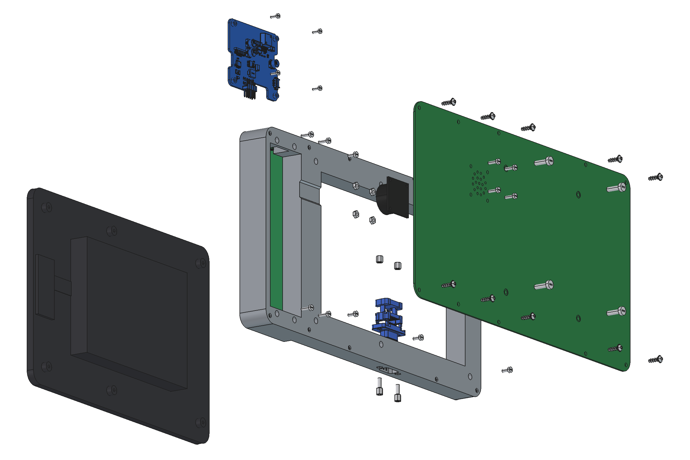

# Assembly drawings

Assembly drawings for both variants, A3 landscape, 2 sheets each: exploded view
with position balloons, parts list, order of assembly, assembled views and
overall size.

| Variant | Drawing |
|---|---|
| 1: without keypad | [JC8012P4A1C_assembly_variant1.pdf](JC8012P4A1C_assembly_variant1.pdf) |
| 2: with keypad (F1-F12) | [JC8012P4A1C_assembly_variant2_keypad.pdf](JC8012P4A1C_assembly_variant2_keypad.pdf) |

Positions 1-20 are those of [../assembly_bom.csv](../assembly_bom.csv)
(the notes there give lengths, torques and cable details). Letters are the
main parts: A display, B CAN board, C frame, D back plate, E keypad PCB.

## Make the drawings again

1. `freecad.exe make_assembly.py` (FreeCAD 1.1, the GUI is needed for the
   renderings; it closes itself). It exports the STEP files of the four PCBs
   with `kicad-cli` into `cache/` (not in the repository; set `KICAD_CLI` if
   kicad-cli is not in `C:\Program Files\KiCad\10.0\bin`), builds both
   assemblies in frame coordinates and writes `img/variant*_*.png` and
   `img/variant*_views.json` (camera, balloon anchors, overall size).
   `ASSY_VARIANTS=1` or `2` renders one variant only.
2. `python make_assembly_pdf.py` (PyMuPDF, Pillow) makes the two PDFs from
   `img/`. Balloons are placed automatically next to their anchor points.

## Models

- `models/JC8012P4A1_envelope.step`: envelope model of the display made from
  the dimensions of `JC8012P4A1.dwg` (Guition structure diagram): frame, cover
  glass, 6 brass posts, display cover, connector block. No inner parts.
- `models/D-Sub_Wurth_618009221923.step`, `models/Jackpost_Wurth_94513200.step`,
  `models/HexNut_Wurth_94505009.step`: Würth Elektronik models (see `Wurth_Disclaimer_READ_ME.txt`).
- Screws, nuts, speaker, plexiglass and foil are simple models made in the script.
  The WÜPLAST 3 × 10 (pos. 8, 17) use the original Würth model
  `models/WUEPLAST_Wuerth_4234_3_10.step` if it is there. It is not in the repository
  (Würth gives no licence to pass the CAD data on): download it yourself from
  [cad.wuerth.com](https://cad.wuerth.com/) (article 4234 3 10, STEP) and save it under
  this name. Without the file the script uses a simple screw model.
  TODO: Würth models for the other screws, see [render/README.md](render/README.md).

## Simplifications

- The position of the CAN board under the display cover is schematic (J2 below
  FPC3, on the standoffs S1-S4 of the display board); the envelope model has no
  display board.
- Cables (positions 2, 4-6, 11, 12, 18) are not shown.
- The VESA bracket is not shown, only its screws (position 10).
