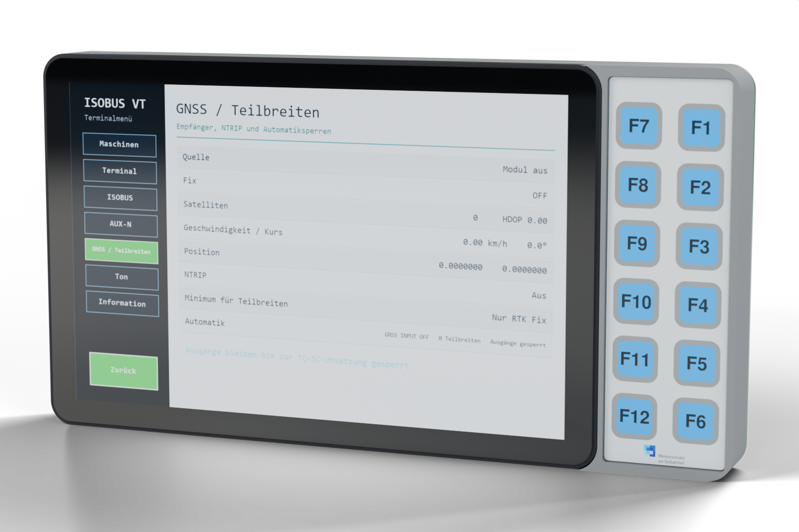
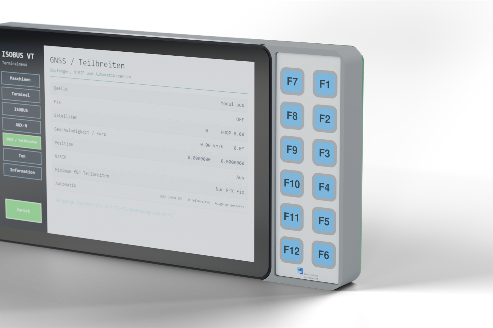
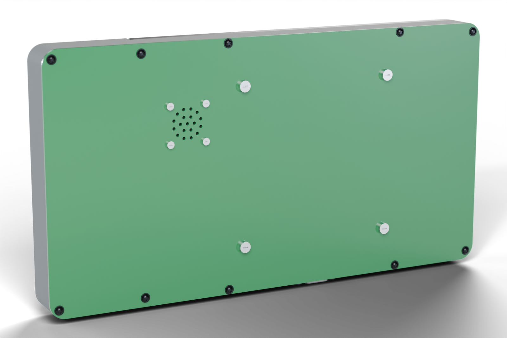
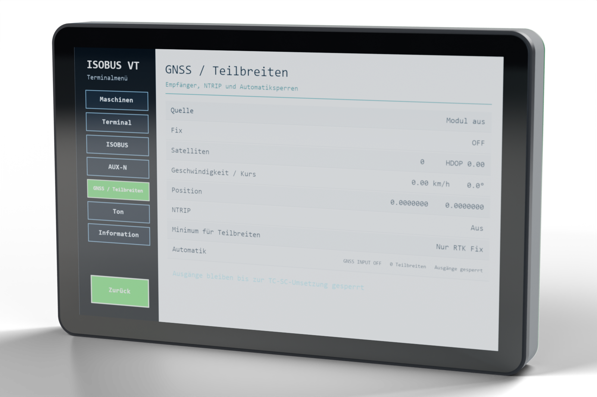

# Renderings (Blender)

Photo-like pictures of the unit, rendered with Blender (Cycles) from the same geometry
as the assembly drawings. The keypad foil carries the real print of the Folika drawing,
the screen shows the espVT page "GNSS / Teilbreiten".

| Variant 2, front | Variant 2, keypad |
|---|---|
|  |  |
| **Variant 2, back** | **Variant 1, front** |
|  |  |

## Make the pictures again

Blender 5.3, FreeCAD 1.1, Python with PyMuPDF and Pillow.

1. `python make_textures.py`: `tex/foil.png` from
   `../../pcbs/keypad/docs/folika_keypad_12.pdf` (the foil outline of the 1:1 drawing) and
   `tex/screen.png` (screen redrawn at 1280 × 800).
2. Export the parts as STL (frame coordinates, mm) into `cache/variant<n>/`
   (not in the repository), in `..`:
   `ASSY_EXPORT=1 ASSY_VARIANTS=1,2 freecad.exe make_assembly.py`
3. Render (about 1–2 min per picture on the CPU):
   `blender --background --python render_blender.py -- <variant> <view> [samples] [width] [output]`
   with view `front`, `keypad` or `back`. Default 256 samples, 1600 px, output
   `../img/render_variant<n>_<view>.png` (transparent background with shadow).

## Notes

- Materials: frame MJF PA12 (matt grey with a fine grain), black cover glass, foil satin
  with the print, back plate and PCBs green solder mask, WÜPLAST screws black zinc, other screws steel.
- The foil is modelled flat. In reality it forms a dome over each key (about 0.4 mm), so the
  keypad PCB is moved back by 0.6 mm in the picture, otherwise the actuators would show through.
- The display is the envelope model (`../models/JC8012P4A1_envelope.step`); the active area
  216.96 × 135.36 mm is assumed to be centred on the glass.
- Lighting: Blender's built-in studio HDRI plus three area lights, no downloads needed.

## TODO

- Screws: the WÜPLAST WN 1451 3 × 10 (Würth 4234 3 10, black zinc plated, pos. 8 and 17) use
  the original Würth model `../models/WUEPLAST_Wuerth_4234_3_10.step` (simple model if the
  file is missing). The file is not in the repository, because Würth gives no licence to pass
  the CAD data on: download article 4234 3 10 as STEP from [cad.wuerth.com](https://cad.wuerth.com/). Still simple models: M2 × 6 (pos. 1), M2.5 (pos. 9, 14, 16), M4 × 12
  (pos. 10) and the M2.5 nuts (pos. 15); replace them with Würth models as well.
