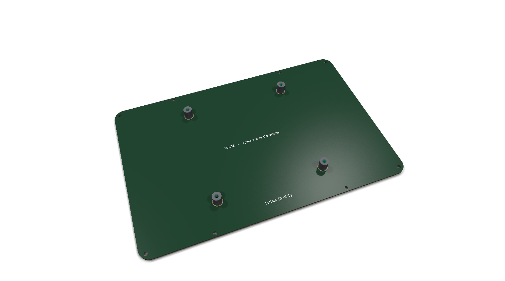

# JC8012P4A1C back plate

Back plate for the JC8012P4A1C_I_W_Y display with the CAN addon board. It closes
the frame at the back and carries a VESA 100 mount. KiCad 10 project, made as a
bare PCB.



- FR4 1.6 mm, 2 layers, **no copper pours**: the WLAN antenna is glued into
  the display cover directly behind the plate. Do not make it from an
  aluminium PCB.
- Outline 242.8 × 158.7 mm, corner radius 10 mm (outer size of the display
  shell and of the frame).
- H1–H4: Würth WA-SMSI 9774100482R SMD steel spacers, M4 internal thread,
  L 10 mm, soldered on the **inside** (F side) on the VESA 100 × 100 grid.
  The land pattern is the one from the datasheet (pad right up to the
  5.4 mm non-plated hole), so `JC8012P4A1C_backplate.kicad_dru` allows the
  pad-to-hole clearance for these footprints.
- H5–H12: 3.2 mm holes for the screws to the frame (Würth WÜPLAST WN 1451
  3 × 10, thread forming, into the plastic bosses of `../mechanics`): 4 in
  the corners, 2 at the top and 2 at the bottom at ±60 mm. Positions =
  `SCREWS` in `make_frame.py`.
- The M4 spacers stand next to the display cover (the cover is 93.5 mm wide,
  the spacers are at ±50 mm), with about 8 mm clearance to the display back.
- Text on the outside (B side): project name, VESA marking, D-Sub at the
  bottom.

Coordinates: board centre (150, 100). In the PCB editor the F side (spacers)
is the inside. The bottom edge of the display (D-Sub) is +y.

Open points:

- Check the width of the display cover at the spacers on the real part
  (spacer edge at 45.9 mm from the centre).
- Speaker: the display board has a speaker connector. Speaker and opening
  are still to be chosen.

## Manufacturing

Files in `production/`: Gerber and drill files in the zip
`production/JC8012P4A1C_backplate_gerber.zip` (ready for upload), the BOM in
`production/JC8012P4A1C_backplate_bom.csv` (4 × M4 spacers). JLCPCB: 2 layers,
1.6 mm, FR4. Stencil for the top side (spacers). Make them again after changes (the commands write to `production/gerber/`,
which is not in the repository; zip its content to the zip above):

```
kicad-cli pcb export gerbers -o production/gerber -l F.Cu,B.Cu,F.Paste,B.Paste,F.Silkscreen,B.Silkscreen,F.Mask,B.Mask,Edge.Cuts --subtract-soldermask --no-x2 --no-netlist JC8012P4A1C_backplate.kicad_pcb
kicad-cli pcb export drill -o production/gerber/ --format excellon --excellon-units mm --excellon-separate-th JC8012P4A1C_backplate.kicad_pcb
kicad-cli sch export bom -o production/JC8012P4A1C_backplate_bom.csv --fields "Reference,QUANTITY,Value,Manufacturer,MPN,Footprint,DNP" --labels "Reference,Qty,Value,Manufacturer,MPN,Footprint,DNP" --group-by "Value,Footprint,MPN,Manufacturer,DNP" JC8012P4A1C_backplate.kicad_sch
```
