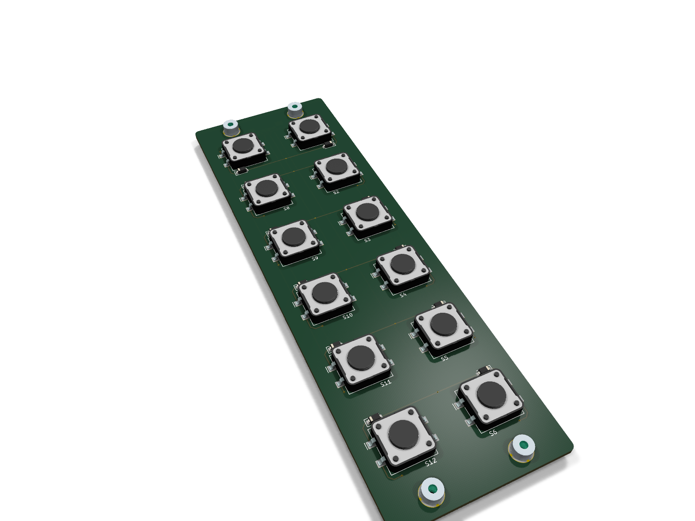
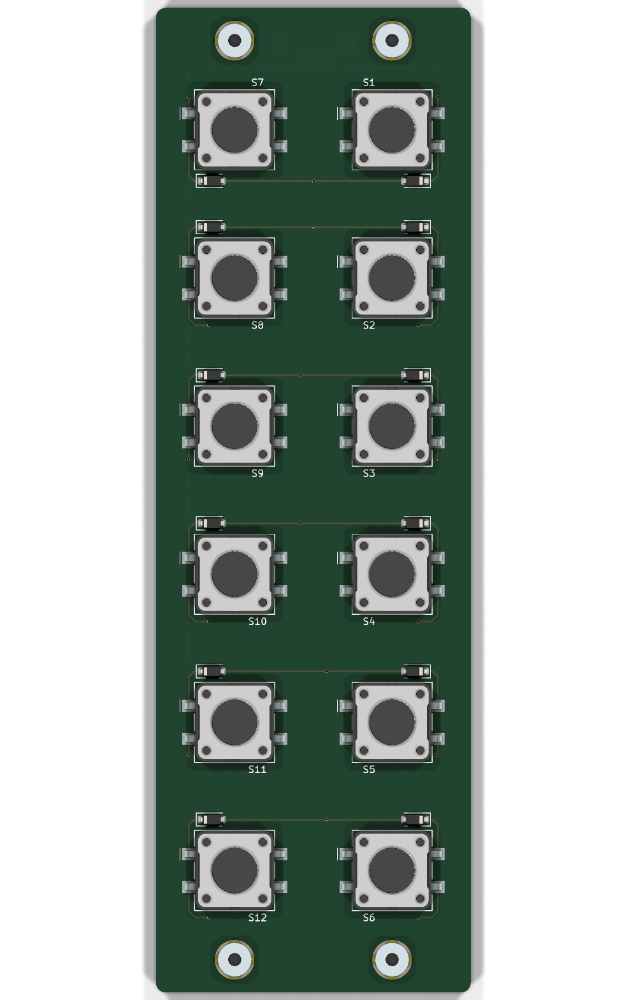
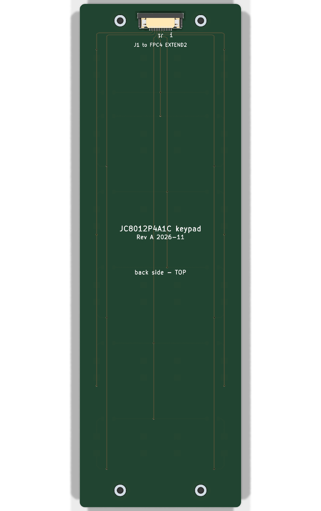

# JC8012P4A1C keypad (variant 2)

Keypad with 12 keys (2 columns x 6 rows) right of the display, seen from the
**front**. KiCad 10 project. Used together with the frame `../mechanics/frame_keypad.stl`
and the wide back plate `../backplate_keypad`.



| front (keys) | back (J1) |
|---|---|
|  |  |

## Sandwich

Same principle as the 4 key board `ISOBUS_Hardware/XL-accessories/Board_4_Buttons`
(Folika FO SON PU 005):

| Layer | Thickness |
|---|---|
| PU foil, printed, 3M 468MP adhesive, no adhesive in the key fields | rest |
| plexiglass 3 mm with pockets for the keys, 3M 300LSE adhesive | 3.0 mm + adhesive |
| PCB FR4 | 1.6 mm |
| **total (flat part, measured at the edge)** | **5.5 mm** |

- Outline 48 x 150 mm, corner radius 1.5 mm, the same for foil, plexiglass and PCB.
- Plexiglass: 16.3 x 16.3 mm pockets for the keys (key 12 mm, enlarged for the
  solder tabs), dia 6.6 mm holes for the spacers H1-H4. Each pocket has a notch
  5.8 x 1.45 mm for the diode (notch centre 3.5 mm from the key centre towards
  the outer edge, notch edge 9.6 mm from the key centre). Top row: notch below
  the key, all other rows: above the key, so the notch keeps away from the
  spacer holes.
- The actuator (4.3 mm above the PCB) pushes the foil about 0.4 mm outwards,
  as on the 4 key board.
- Print in the style of FO SON PU 005: light grey background (2 mm bleed),
  14 mm key fields in colour with a 2 mm grey frame, labels F1-F12 in Arial Bold,
  school logo below the keys.
- Cutting drawing for Folika (1:1, A4) and DXF:
  [docs/folika_keypad_12.pdf](docs/folika_keypad_12.pdf),
  [docs/folika_keypad_12.dxf](docs/folika_keypad_12.dxf).

## Mounting in the frame

- The sandwich lies in a pocket of the frame. The foil is **2 mm behind the
  glass front** of the display (z = 23 in frame coordinates, glass z = 25), the
  domes over the actuators stay about 1.5 mm behind the glass plane, so nothing
  is pressed when the unit lies on its front. The frame edge protects the edge
  of the foil.
- The back of the PCB rests on a ledge of the frame (z = 17.5).
- H1-H4: Wurth WA-SMSI 9774030151R, SMD steel spacers M2.5, L 3 mm, soldered on
  the front side in the same reflow run as the keys. They sit in the holes of
  the plexiglass, 0.1 mm or more below the foil.
- Screws **M2.5 x 8** from behind through the 4 mm lugs of the frame and the PCB
  into the spacers (2.4 mm thread). **Do not use longer screws**, an M2.5 x 10
  pushes through the foil. Max. 0.35 Nm (spacer). The same screw is used for
  the speaker.
- The key forces go into the ledge, the screws only hold the sandwich.

## Electrics

3 x 4 key matrix with one diode per key (no ghost keys, any number of keys at
the same time), read by the component
[keyboard_button](https://docs.espressif.com/projects/esp-iot-solution/en/latest/input_device/keyboard_button.html)
of esp-iot-solution: the outputs drive high one after another, the inputs use
the internal pull-down (`active_level = 1`). No LEDs, no supply needed on the
keypad.

J1 (Wurth WR-FPC 68711414522, 14 pin, 0.5 mm, on the **back** side, at the top
edge) -> FFC -> FPC4 "EXTEND2" of the display board. FPC4 carries GPIO28-34 on
pins 6-12 (none of them has an ADC, so a resistor ladder is not possible).
The GPIO list below is only valid with a cable that connects pin n to pin n.

| J1 / FPC4 pin | GPIO | Net | Use |
|---|---|---|---|
| 1, 2 | GND | - | not used |
| 3, 4, 5 | - | - | not connected on the display board |
| 6 | GPIO28 | IN0 | input |
| 7 | GPIO29 | IN2 | input |
| 8 | GPIO30 | OUT1 | output |
| 9 | GPIO31 | OUT0 | output |
| 10 | GPIO32 | OUT2 | output |
| 11 | GPIO33 | IN3 | input |
| 12 | GPIO34 | IN1 | input (strapping pin for the JTAG source, only with eFuse, not set by default) |
| 13, 14 | VDDA | - | not used |

```c
keyboard_btn_config_t cfg = {
    .output_gpios = (int[]){31, 30, 32},       // OUT0, OUT1, OUT2
    .output_gpio_num = 3,
    .input_gpios = (int[]){28, 34, 29, 33},    // IN0, IN1, IN2, IN3
    .input_gpio_num = 4,
    .active_level = 1,
    .debounce_ticks = 2,
    .ticks_interval = 500,
    .enable_power_save = false,
};
```

Key numbering as on the CCI 60 terminal, seen from the front: F1-F6 in the
outer (right) column, F7-F12 in the column next to the display, each top to
bottom. The reference designators follow it: Sn is key Fn, Dn its diode.

| Row | left column, next to the display | right column, outer |
|---|---|---|
| 1 | F7 OUT0 / IN0 | F1 OUT0 / IN1 |
| 2 | F8 OUT0 / IN2 | F2 OUT0 / IN3 |
| 3 | F9 OUT1 / IN0 | F3 OUT1 / IN1 |
| 4 | F10 OUT1 / IN2 | F4 OUT1 / IN3 |
| 5 | F11 OUT2 / IN0 | F5 OUT2 / IN1 |
| 6 | F12 OUT2 / IN2 | F6 OUT2 / IN3 |

Key pitch 22.56 mm vertical (active area of the LCD 135.36 mm / 6, so every key
is level with one soft key field of the screen) and 24 mm horizontal.

## PCB

48 x 150 mm, 1.6 mm, 2 layers. Keys, diodes and spacers on the front (F),
only J1 on the back (B). Tracks 0.25 mm (0.2 mm at J1) with 45° corners, vias 0.6 / 0.3 mm.
The diodes (SOD-123) sit next to each key, in the notches of the plexiglass pockets
(above the key, below it in the top row). Top row: the diode is on pads 3/4
and the input on pads 1/2, the other rows the other way round.

## Parts

[production/JC8012P4A1C_keypad_bom.csv](production/JC8012P4A1C_keypad_bom.csv),
interactive BOM [production/JC8012P4A1C_keypad_ibom.html](production/JC8012P4A1C_keypad_ibom.html).

| Ref | Part |
|---|---|
| S1-S12 | Wurth WS-TASV 430162043826, SMT tact switch 12 x 12 mm, H 4.3 mm, 260 g |
| D1-D12 | small signal switching diode, >= 30 V, >= 100 mA, SOD-123 (MPN TBD) |
| H1-H4 | Wurth WA-SMSI 9774030151R, M2.5, L 3 mm |
| J1 | Wurth WR-FPC 68711414522 |

## Manufacturing

Gerber and drill files: `production/JC8012P4A1C_keypad_gerber.zip`
(2 layers, 1.6 mm). Stencil for the **top side** (keys, diodes, spacers). J1 on
the back is soldered by hand afterwards (it sits at the edge). Commands as for
the back plate (see `../backplate/README.md`), with the project name
`JC8012P4A1C_keypad`.

## Open points

- Diode MPN (SOD-123).
- FFC: 14 pin, 0.5 mm, about 250 mm. The cable runs from FPC4 through the slot
  in the display cover, along the top of the frame, through the slot in the
  side wall into the chamber and enters J1 from the top edge. Check length and
  type (contacts on the same side or opposite sides) with a paper strip on the
  test print: pin 1 must end on pin 1, otherwise the GPIO list above is wrong.
- Colour of the key fields on the foil: one blue for all keys for now.
