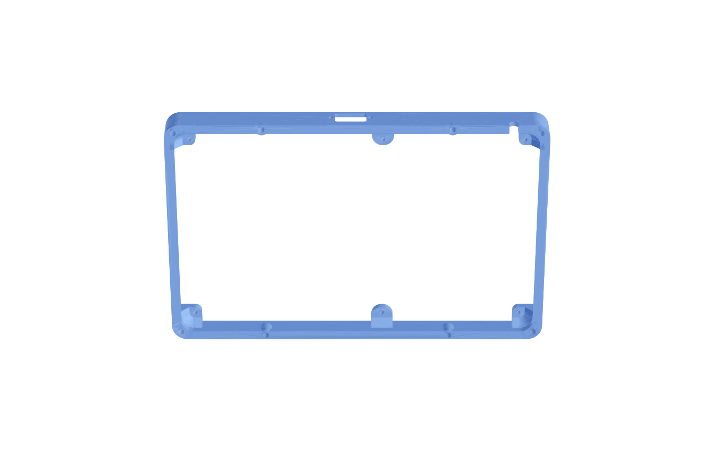

# Frame

3D printed frame between the display and the back plate (`../backplate`).

Based on **"Guition 10.1" ESP32P4 / JC8012P4A1C wall mount" by 8bitmcu**,
<https://www.thingiverse.com/thing:7208630>, licensed
[CC BY-SA](https://creativecommons.org/licenses/by-sa/4.0/). The original
files are in `source/`. The modified frame in this folder is licensed CC BY-SA
as well (see [LICENSE.md](LICENSE.md)), not GPL like the rest of the repository.

## Files

| File | Content |
|---|---|
| `make_frame.py` | FreeCAD script, all dimensions as parameters at the top |
| `frame.step`, `frame.stl` | result (STL for the slicer) |
| `source/` | original landscape frame (STEP), licence and readme of the original |
| `docs/` | preview images |

Make the frame again: `freecadcmd make_frame.py` (FreeCAD 1.1).

## Changes to the original

1. **D-Sub 9** (Würth 618009227221) in the bottom wall, centre 4 mm off the
   middle, on the side away from the middle display boss (x = -4, the boss is
   at x = +16.4), so that the IDC body clears the boss. Cutout 20 × 11 mm for the mating plug,
   jackpost holes 3.2 mm with 25 mm pitch. The wall is thinned locally to
   2 mm, and the flange (12.5 mm) sits in the pocket between the back rim
   (z 0–3) and the display (z 18).
2. **8 bosses** (Ø 8 mm, 9 mm high) with 4.0 mm holes for M3 heat-set
   inserts (e.g. M3 × 5.7, OD 4.6), for the screws of the back plate. The
   positions match the M3 holes H5–H12 of the back plate.
3. **Keyhole tabs** for wall mounting removed: the back plate carries a
   VESA 100 mount.

The 6 bosses to the display (M2.5 × 8, onto the brass posts of the display)
and the small cable hole at the bottom right are unchanged.

## Coordinates

As in the original STEP: x = long side, y = short side, +y = top of the
display (landscape), -y = bottom (D-Sub). z = 0 is the back (back plate),
the display back rests on the wall at z = 18.

## Open points

- Jackpost length for the D-Sub (Würth WE-HEX, UNC 4-40): wall 2 mm +
  flange, check the thread length in the datasheet.
- Speaker and its opening.
