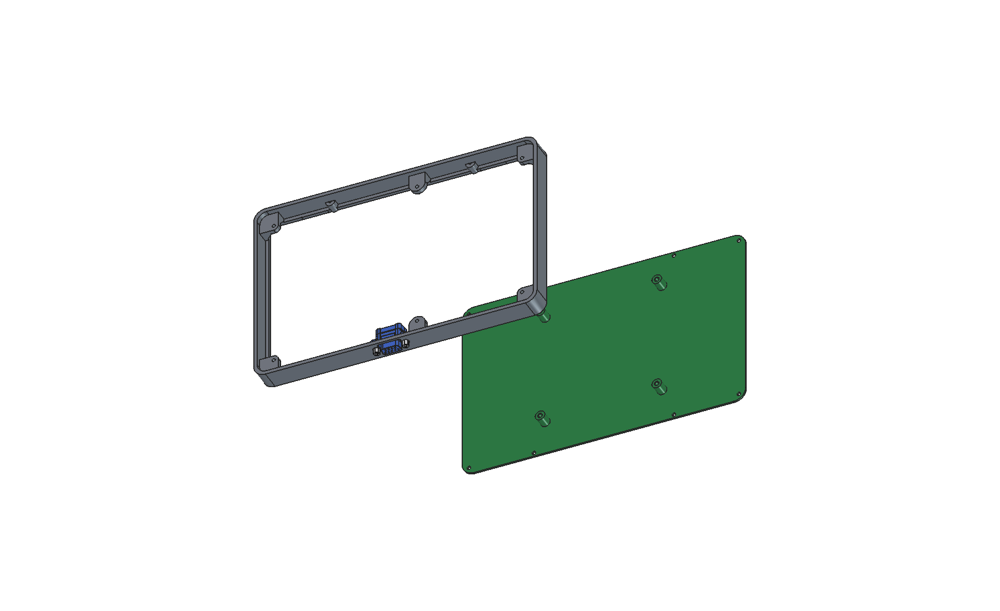
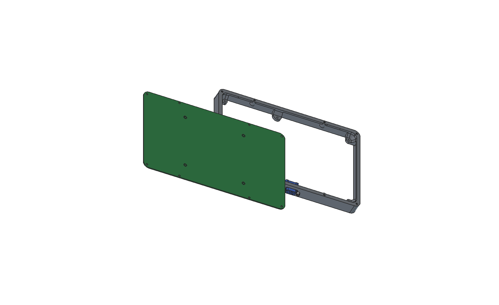
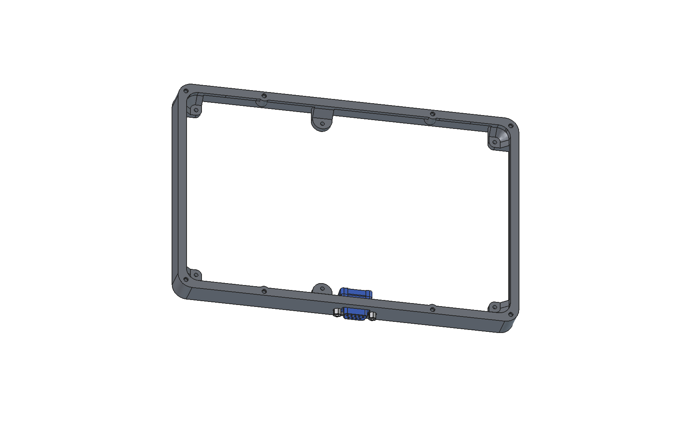
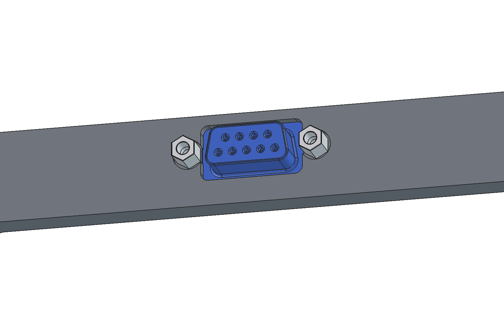
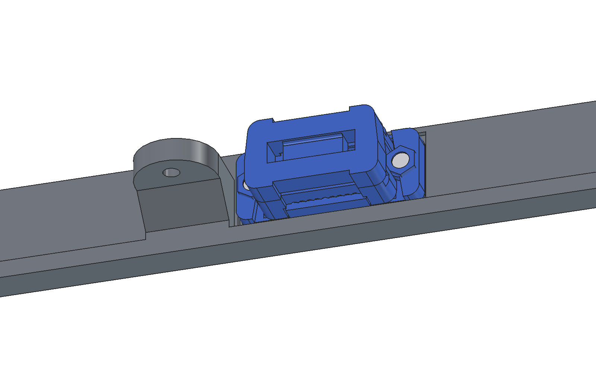

# Frame

3D printed frame between the display and the back plate (`../backplate`).

| | |
|---|---|
|  |  |
|  |  |

Based on **"Guition 10.1" ESP32P4 / JC8012P4A1C wall mount" by 8bitmcu**,
<https://www.thingiverse.com/thing:7208630>, licensed
[CC BY-SA](https://creativecommons.org/licenses/by-sa/4.0/). The original
files are in `source/`. The modified frame in this folder is licensed CC BY-SA
as well (see [LICENSE.md](LICENSE.md)), not GPL like the rest of the repository.

## Files

| File | Content |
|---|---|
| `make_frame.py` | FreeCAD script, all dimensions as parameters at the top |
| `frame.step`, `frame.stl` | result (STL for the slicer) |
| `source/` | original landscape frame (STEP), licence and readme of the original |
| `docs/` | renderings (FreeCAD), with the back plate from `../backplate` |

Make the frame again: `freecadcmd make_frame.py` (FreeCAD 1.1).

## Changes to the original

1. **D-Sub 9** (Würth 618009227221) in the bottom wall, centre 7 mm off the
   middle, on the side away from the middle display boss (x = -7, the boss is
   at x = +16.4), so that the flange clears the web of the boss. Cutout 20 × 11 mm for the mating plug,
   jackpost holes 3.2 mm with 25 mm pitch. The flange (12.5 mm) sits in a
   pocket on the inside between the back rim (z 0–3) and the display (z 18),
   and the wall there is 2.0 mm. The mating plug rests on the jackpost hex,
   so every mm of wall under the hex costs mating depth: the hexes sit in
   **Ø 6.0 × 1.0 mm counterbores**, 1.0 mm wall under them (1 mm less mating
   depth than a D-Sub without a panel). The
   threaded bushes of the 618009227221 stand 0.3 mm in front of the flange and
   get a 5.8 × 0.4 mm recess (0.6 mm wall left under the hex). Jackposts:
   Würth 94510000 (UNC 4-40, hex 5.0, thread 5.0), 4.2 mm thread in the
   4.6 mm bush. Checked against the Würth STEP models of 618009227221,
   618009221923 and 94510000: no collision.
2. **8 bosses** (Ø 8 mm, 9 mm high) for the screws of the back plate:
   Würth WÜPLAST WN 1451 3 × 10 (art. 4234 3 10), thread forming screws for
   thermoplastics. Designed to the EJOT PT rules (same thread form): pilot
   hole 2.4 mm through the whole boss, relief bore 3.2 × 1.2 mm at the entry,
   7.2 mm thread engagement (≥ 2 × d). If the screws go in too hard in the
   printed frame, increase `SCREW_PILOT_D` to 2.5. The positions match the holes H5–H12 of the back plate.
3. **Keyhole tabs** for wall mounting removed: the back plate carries a
   VESA 100 mount.
4. **Cable notch** at the bottom closed: power and CAN come through the
   D-Sub.

The 6 bosses to the display (M2.5 × 8, onto the brass posts of the display)
are unchanged.

## Coordinates

As in the original STEP: x = long side, y = short side, +y = top of the
display (landscape), -y = bottom (D-Sub). z = 0 is the back (back plate),
the display back rests on the wall at z = 18.

## Open points

- Jackpost length for the D-Sub (Würth WE-HEX, UNC 4-40): wall 2 mm +
  flange, check the thread length in the datasheet.
- Speaker and its opening.
