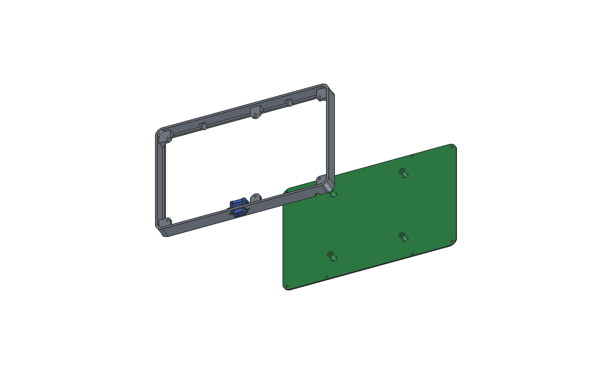
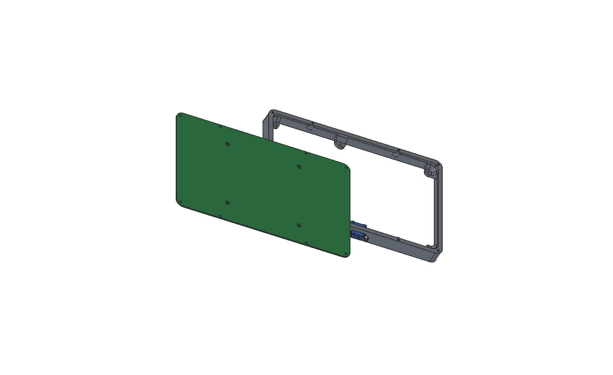
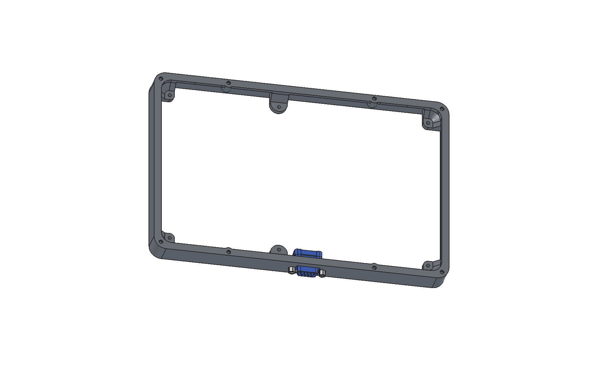
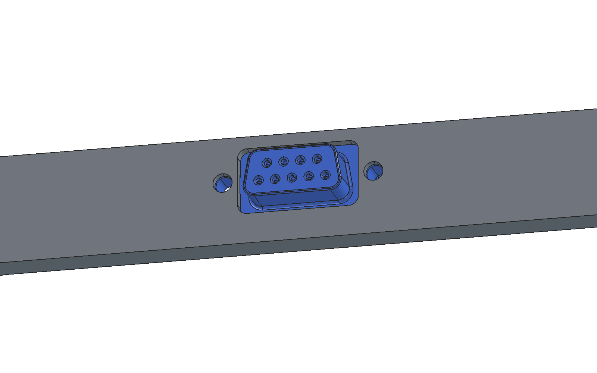
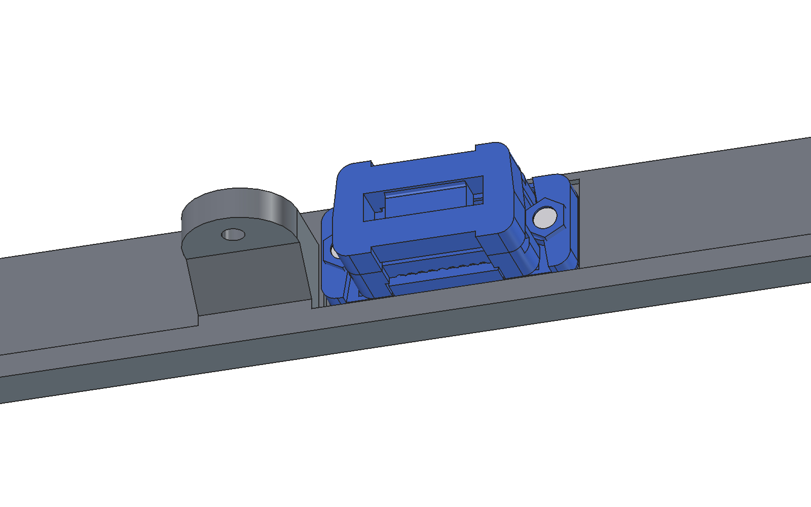
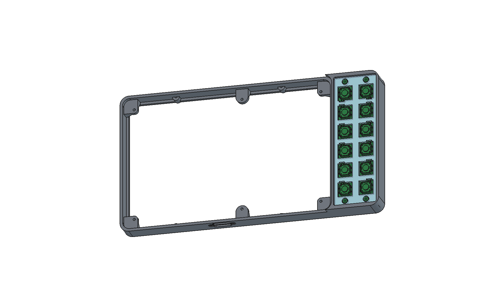
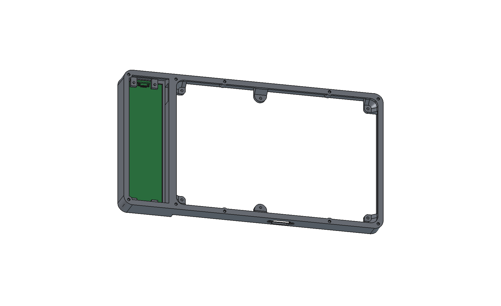
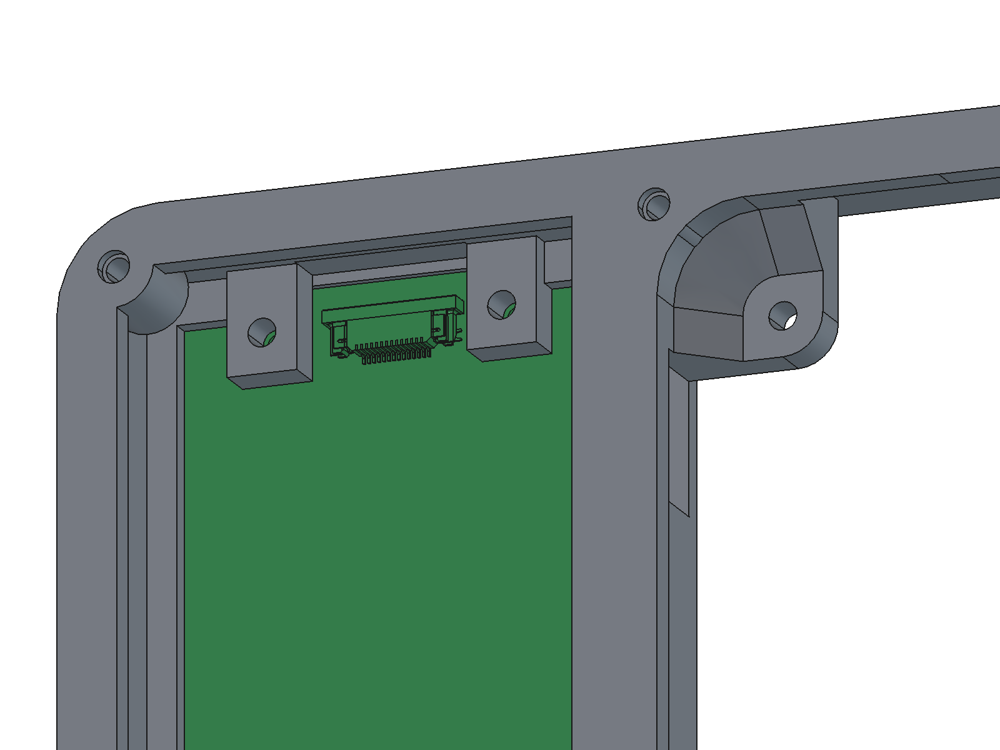

# Frame

3D printed frame between the display and the back plate (`../backplate`).

| | |
|---|---|
|  |  |
|  |  |

Based on **"Guition 10.1" ESP32P4 / JC8012P4A1C wall mount" by 8bitmcu**,
<https://www.thingiverse.com/thing:7208630>, licensed
[CC BY-SA](https://creativecommons.org/licenses/by-sa/4.0/). The original
files are in `source/`. The modified frame in this folder is licensed CC BY-SA
as well (see [LICENSE.md](LICENSE.md)), not GPL like the rest of the repository.

## Files

| File | Content |
|---|---|
| `frame.f3d`, `frame_keypad.f3d` | Fusion source files of both frames |
| `frame.step`, `frame.stl` | frame, variant 1 (STL for the slicer), exported from Fusion |
| `frame_keypad.step`, `frame_keypad.stl` | variant 2 with the keypad chamber (see below) |
| `source/` | original landscape frame (STEP), licence and readme of the original |
| `docs/` | renderings (FreeCAD), with the back plate from `../pcbs/backplate` |
| `../assembly/` | assembly drawings of both variants (PDF) and their scripts, see [../assembly/README.md](../assembly/README.md) |

The Fusion files (`*.f3d`) are the source of the frame now. The frames were reworked in Fusion in November 2026
to make the frame stiffer, with the new D-Sub mounting (see 1. below). The earlier FreeCAD
script `make_frame.py` is removed (it is in the git history); the numbers in 2.–4. and in the
keypad section are from that version.

## Changes to the original

1. **D-Sub 9** (Würth 618009221923, IDC, without nuts) in the bottom wall, centre
   x = -7, z = 9.0 (away from the middle display boss at x = +16.4). The wall is
   **6.0 mm** thick there, with a D cutout about 17.5 × 9 mm for the shell and jackpost
   holes 3.2 mm with 25 mm pitch.
   - Jackposts Würth **94513200** (WA-HEX, UNC 4-40, hex 5.0 SW 4.5, thread 8.2) go from
     outside into **5.0 mm deep hex pockets**, 1.0 mm wall under the hex.
   - The D-Sub goes from inside over the threads, its flange lies on the inside of the
     wall. Outside, wall, jackpost hexes and D-Sub shell (6.0 mm in front of the flange)
     are flush.
   - Nuts Würth **94505009** (WA-HEX, SW 4.5, 5 mm) from inside. Clamped length 4.76 mm
     (wall 1.0, flange 0.4, body 3.0, rivet collar 0.36), so 3.4 mm of the thread are in
     the nut (5.4 turns, more than 1 × d); the thread ends inside the nut.
   - Tighten the nuts only lightly (about 0.1 Nm): the 1.0 mm wall under the hex takes the
     whole preload (0.3 Nm, usual for 4-40 in metal, would give about 500 N and press the hex
     into the plastic). Secure them with locking lacquer (e.g. Loctite 7400) over nut and
     thread end; no liquid threadlocker (Loctite 2xx), it attacks ABS.
   - A socket SW 4.5 hits the IDC cover and the strain relief: tighten the nuts before
     they are on, afterwards only an open-end wrench fits.
   - Checked in FreeCAD with the Würth STEP models: no collision with the frame
     or the display.
2. **8 bosses** (Ø 8 mm, 9 mm high) for the screws of the back plate:
   Würth WÜPLAST WN 1451 3 × 10 (art. 4234 3 10), thread forming screws for
   thermoplastics. Designed to the EJOT PT rules (same thread form): pilot
   hole 2.4 mm through the whole boss, relief bore 3.2 × 1.2 mm at the entry,
   7.2 mm thread engagement (≥ 2 × d). If the screws go in too hard in the
   printed frame, make the pilot holes 2.5 mm. The positions match the holes H5–H12 of the back plate.
3. **Keyhole tabs** for wall mounting removed: the back plate carries a
   VESA 100 mount.
4. **Cable notch** at the bottom closed: power and CAN come through the
   D-Sub.

The 6 bosses to the display (M2.5 × 8, onto the brass posts of the display)
are unchanged.

## Coordinates

As in the original STEP: x = long side, y = short side, +y = top of the
display (landscape), -y = bottom (D-Sub). z = 0 is the back (back plate),
the display back rests on the wall at z = 18, the glass front of the display
is at z = 25 (display module 7 mm). +x is on the right seen from the front,
on the left seen from behind.

## Variant 2: frame with keypad chamber

`frame_keypad.step` and `frame_keypad.stl`: the same frame with a chamber on +x for the keypad
`../keypad` (12 keys). Close it with the wide back plate `../backplate_keypad`.

| front (foil hidden) | from behind, keypad mounted |
|---|---|
|  |  |

- Total width 296.9 mm (chamber 54.1 mm). The frame no longer fits a printer
  with a 256 mm bed.
- Partition 2 mm between the display shell (0.5 mm gap) and the keypad pocket,
  from z = 18 to the glass plane z = 25. Outer wall 3 mm.
- At the top and bottom the front part (z 18 .. 25) follows the rounded corners
  of the display (R 10.1 + 0.5 mm gap), so there is no notch between display
  and keypad chamber. The fill runs out thin at the tangent points.
- Pocket corners R 1.8 (sandwich R 1.5 + 0.3 mm clearance).
- Pocket 48.6 x 150.6 mm (0.3 mm clearance around the 48 x 150 mm sandwich). The
  foil lies 2 mm behind the glass plane, the frame edge is level with the glass.
- Ledge 3 mm wide, 2 mm thick behind the PCB (z = 15.5 .. 17.5); the key forces
  go into it.
- 4 lugs 4 mm thick with 2.8 mm holes for the M2.5 x 8 screws into the spacers
  of the keypad (keypad centre +-12, +-70 mm). Do not use longer screws.
- The ledge is cut at the top for the FFC connector J1 on the back of the
  keypad and for the cable.
- Cable slot 21 x 12.5 mm (y 48 .. 69, z 3.5 .. 16) through the old side wall and
  the partition, for the FFC from FPC4 EXTEND2.
- 2 more bosses for the back plate screws in the new corners (x = 169.8).
- Checked in FreeCAD with the KiCad STEP of the keypad and a model of the
  plexiglass: no collision, actuator tips at z = 23.4.

## Open points

- Speaker and its opening.
- Keypad variant: test print, check the FFC path through the cable slot and
  the fit of the sandwich in the pocket.
