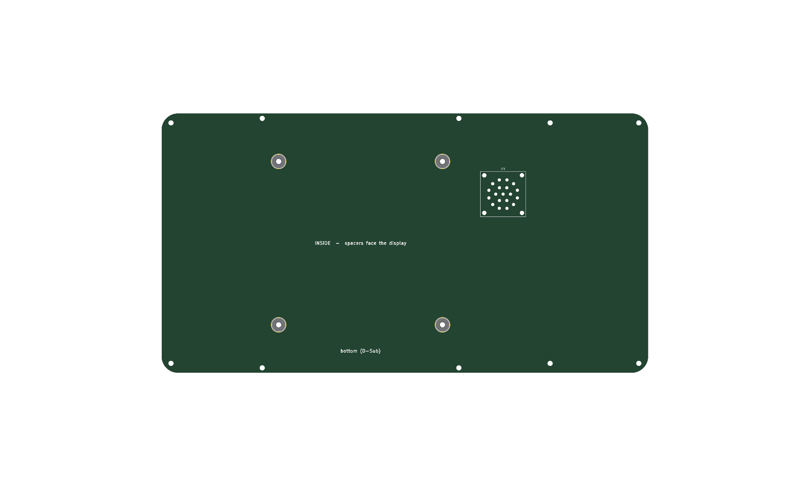

# JC8012P4A1C back plate, keypad variant

Copy of `../backplate`, widened for the keypad chamber of
`../../mechanics/frame_keypad.stl` (variant 2 with `../keypad`). Everything not
listed here is the same as in [../backplate/README.md](../backplate/README.md).

- Outline 296.9 x 158.7 mm, corner radius 10 mm. The board is 54.1 mm wider on
  +x (right side seen from the front, left side seen from behind).
- VESA 100 spacers H1-H4 and the speaker LS1 stay where they are, centred to
  the display, not to the wider housing.
- H5-H12 as before, plus H13/H14 in the new corners (frame x = 169.8,
  y = +-73.6): 10 Wurth WUPLAST 3 x 10 screws in total.
- Coordinates: PCB x = 150 + frame x, PCB y = 100 - frame y.

## Manufacturing

`production/JC8012P4A1C_backplate_keypad_gerber.zip` (2 layers, 1.6 mm, FR4,
no copper pours), BOM `production/JC8012P4A1C_backplate_keypad_bom.csv`,
interactive BOM `production/JC8012P4A1C_backplate_keypad_ibom.html`. Commands as
in `../backplate/README.md` with the project name `JC8012P4A1C_backplate_keypad`.
