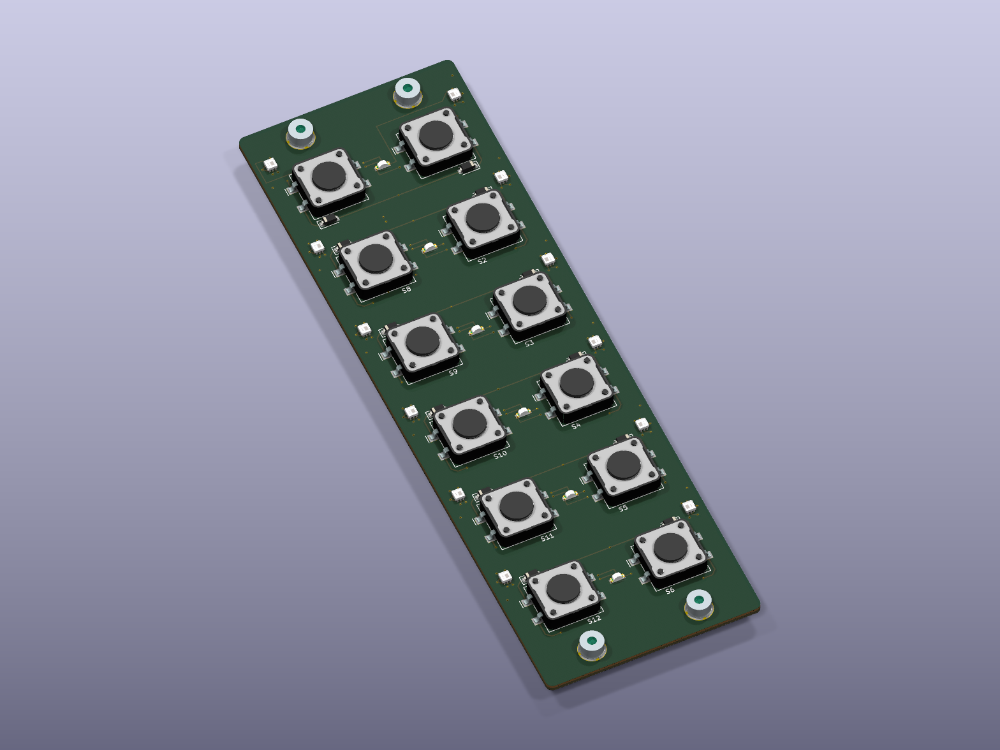
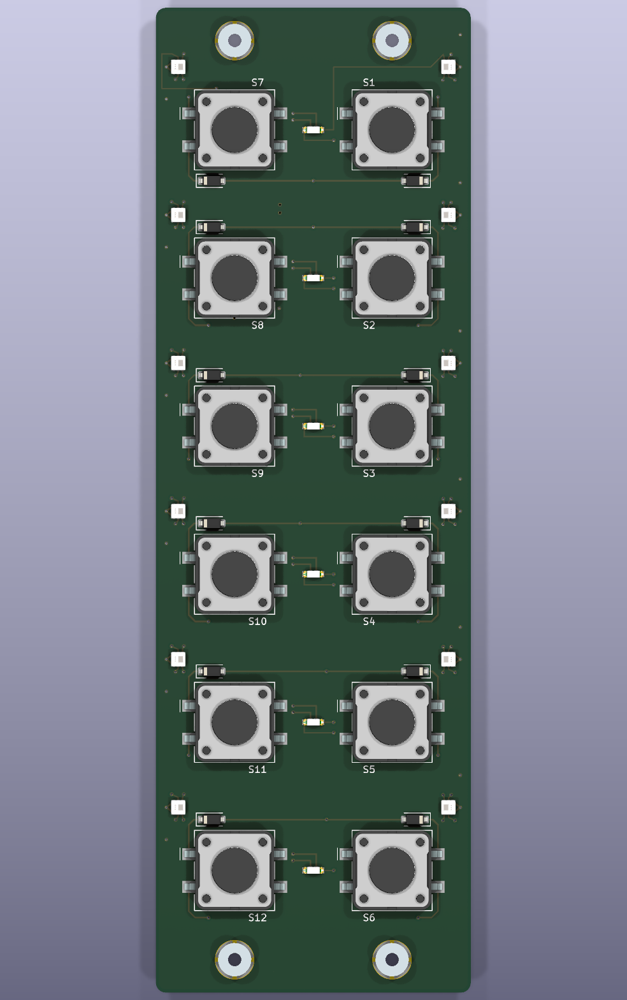
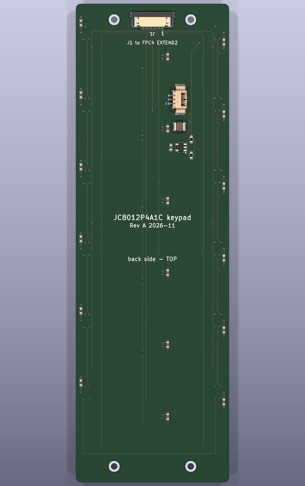

# JC8012P4A1C keypad, variant 2b (backlit)

The keypad of variant 2 (`../keypad`) with a backlight that the CPU can dim, so the keys
can be found at night without dazzling the driver. KiCad 10 project.

| front (keys, LEDs) | back (J1, J2, level shifter, capacitors) |
|---|---|
|  |  |

Everything that is not mentioned here is the same as in `../keypad/README.md`:
the 3 x 4 key matrix on J1 / FPC4, the sandwich, the mounting in the frame and the screws.

## What is new

- **12 x WL-ICLED 2121** (Würth 1312121320437, RGB with controller, 12 bit PWM + 4 bit
  current per colour) under a white **window** of the foil at the outer top corner of
  every key: left column top left, right column top right (like the windows on the
  Fendt keypads).
- **6 x WL-ICLED side view 3210** (Würth 1313210530000) in pockets of the centre strip
  of the plexiglass. They shine down the strip and light the plexiglass, the grey
  background of the foil glows.
- All 18 LEDs are one chain on one data line: **GPIO2** of the display board
  (FPC3 pin 10), through the CAN board 2b (`../can_power_2b`, R11 33 R, J4) and a
  3 wire cable to **J2** on the keypad. FPC4 has no free pin (the matrix uses all
  7 GPIOs, pins 3-5 are not connected on the display board), so the extra cable is needed.
- **U1 74AHCT1G125** on the keypad lifts the 3.3 V data to 5 V (the ICLEDs need
  V_IH = 0.7 x VDD = 3.5 V). R1 100k pulls the input low, the LEDs stay dark
  while the ESP32-P4 boots or when the cable is unplugged.
- The LEDs run on 5 V from the CAN board (buck converter 5 V / 3 A). The 2121 need
  at least 4.2 V. Idle current about 1 mA per 2121 and 2 mA per side view, about 25 mA in total.
- Colours of the keys: left column F7-F12 **dark green** (Pantone 348 C, about RAL 6002),
  right column F1-F6 **light green** (Pantone 375 C, about RAL 6018).

## Chain and firmware

| LED | index | position |
|---|---|---|
| LED1-LED6 | 0-5 | windows of F7-F12 (left column, top to bottom) |
| LED7-LED12 | 6-11 | windows of F6-F1 (right column, bottom to top) |
| LED13-LED18 | 12-17 | background, side views in the centre strip, top to bottom |

The 2121 take 48 bit per LED (per colour 4 bit current + 12 bit PWM), the side views
24 bit (8 bit per colour, like WS2812). Both use the same bit timing (T0H 0.3 µs,
T1H 0.9 µs, period 1.2 µs). The chain therefore needs its own encoder (RMT) instead of
the stock `led_strip` component: 12 x 48 bit, then 6 x 24 bit, then the reset
(at least 200 µs, the side views need it; the 2121 need 50 µs). Night: current gain 0-1 and PWM a few counts of
4095 for the windows, the side views on 1-3 of 255.
**BI** (bypass input) of the 2121 is tied to GND, the bypass is not used.

## J2 (cable from the CAN board 2b)

Würth WR-WTB 653103131822 (3 pin, 1.25 mm, SMT horizontal) on the back, below J1,
opening towards the left board edge. Cable to J4 of the CAN board 2b, pin n to pin n:

| Pin | Signal |
|---|---|
| 1 | +5V |
| 2 | GND |
| 3 | LED data (GPIO2, 3.3 V) |

Housing 653003113322 on both ends (from the 4 pin housing 653004113322, please check),
pre-crimped wires as for the 5 V cable (pos. 12 of the assembly BOM), length still open.
The cable runs together with the FFC through the cable slot of the frame.

## Plexiglass and foil

Drawing for Folika (1:1, A4) and DXF:
[docs/folika_keypad_12_2b.pdf](docs/folika_keypad_12_2b.pdf),
[docs/folika_keypad_12_2b.dxf](docs/folika_keypad_12_2b.dxf),
made by `docs/make_folika_2b.py` (PyMuPDF + shapely).

- Plexiglass (glass clear): additional pocket 3 x 3 mm for every window LED at the outer
  top corner of the key pocket (merged with the diode notch, no thin webs) and
  6 pockets 3.8 x 1.85 mm in the centre strip for the side views.
- Foil: window dia 3 mm, translucent white, centre 8.6 mm beside and 9.6 mm above the key
  centre. Key fields and the grey background printed translucent (no opaque underprint),
  labels black. No adhesive over the windows (dia 4 mm).
- Make a sample first and check how the light spreads and the colours look.

## PCB

48 x 150 mm, 1.6 mm, **4 layers**: F.Cu and B.Cu as in variant 2 (matrix unchanged),
In1.Cu GND plane, In2.Cu +5V plane. LEDs on the front (reflow with the keys),
J2, U1, R1, R2, C1-C20 on the back. The LEDs have no silkscreen (they are under the
plexiglass), see the interactive BOM for the orientation.
ERC, DRC and schematic parity: no errors.

## Parts

[production/JC8012P4A1C_keypad_2b_bom.csv](production/JC8012P4A1C_keypad_2b_bom.csv),
interactive BOM [production/JC8012P4A1C_keypad_2b_ibom.html](production/JC8012P4A1C_keypad_2b_ibom.html).

| Ref | Part |
|---|---|
| S1-S12, D1-D12, H1-H4, J1 | as variant 2 (spacer pads as copper ring 4.2-6.0 mm, 0.25 mm free at the non-plated hole) |
| LED1-LED12 | Würth WL-ICLED 1312121320437 (2121, RGB, 12 bit) |
| LED13-LED18 | Würth WL-ICLED 1313210530000 (side view 3210, RGB) |
| J2 | Würth WR-WTB 653103131822 |
| U1 | TI SN74AHCT1G125DBVR (SOT-23-5) |
| R1 | 100k 0603, R2 33 R 0603 (Yageo) |
| C1 | 10 µF 50 V 1210 Würth 885012209073 |
| C2-C20 | 100 nF 0603 Würth 885012206095 |

## Manufacturing

Gerber and drill files: `production/JC8012P4A1C_keypad_2b_gerber.zip` (4 layers, 1.6 mm).
Two sided assembly: back first (J2 by hand or with its own stencil, U1, R, C), then the
front (keys, diodes, LEDs, spacers) as in variant 2. Commands as for the back plate
(see `../backplate/README.md`) with the project name `JC8012P4A1C_keypad_2b` and the
copper layers `F.Cu,In1.Cu,In2.Cu,B.Cu`.

## Open points

- Check in Fusion that J2 (3.4 mm high) and its plug fit behind the keypad and that the
  3 wire cable fits through the cable slot with the FFC.
- Cable length and housing number (653003113322) from the Würth data sheet.
- Sample of foil and plexiglass: light spread, brightness of the windows, colours.
- Firmware: RMT encoder for the mixed chain (48 bit / 24 bit).
